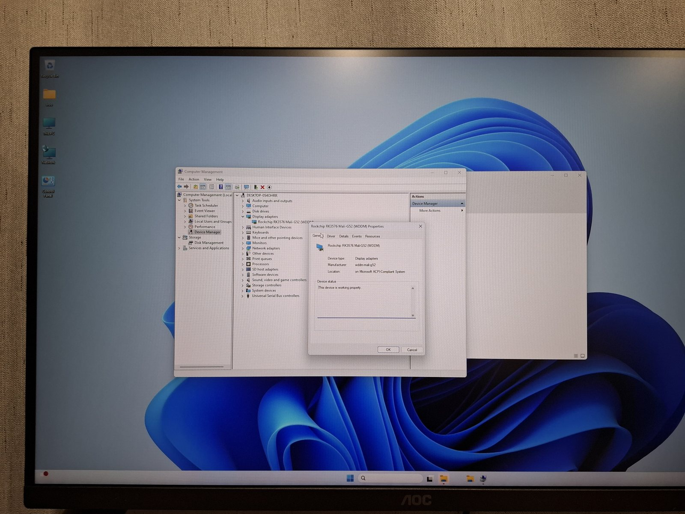
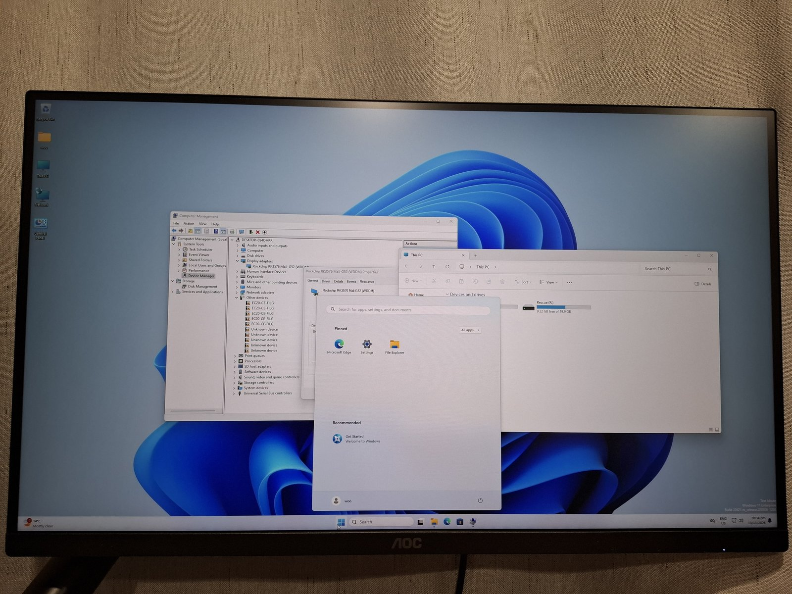
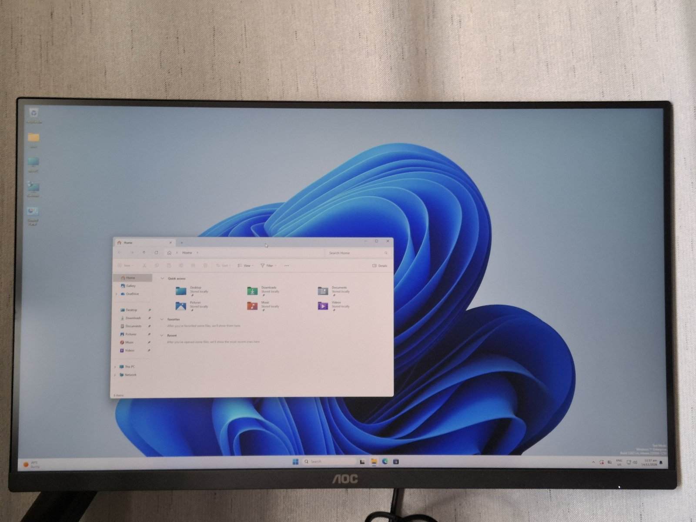
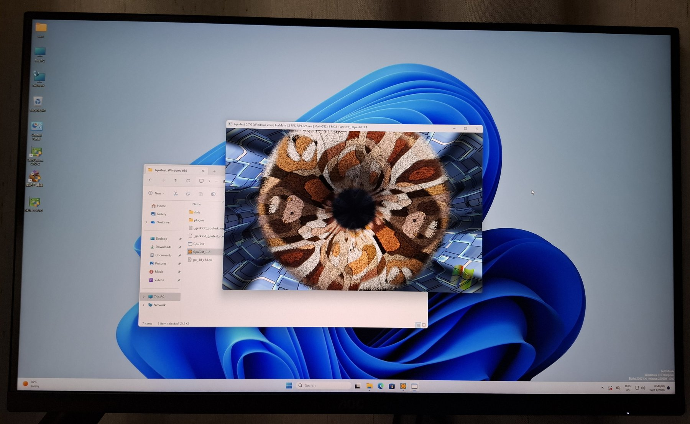

# wddm-mali-g52

A Windows (WDDM) driver for the Arm Mali-G52 GPU in the Rockchip RK3576.

*2026-11-13, LCKFB TaishanPi 3M. Windows 11 lists the Mali-G52 as a working
display adapter and draws its desktop on it: the screen in this photo was
composed on the GPU.*

| | |
|---|---|
|  |  |
| The Start menu, File Explorer and Device Manager, 2026-11-13 | A day later: the display controller reads the frame itself and no pixel is copied on the CPU |

*2026-11-14. FurMark (GpuTest 0.7.0, an x64 program) through the OpenGL 3.1
driver: 285 points at 1024x640 with the GPU at 594 MHz.*

On 2026-11-13 it ran at a frame or two a second. A day later, with the copies
gone and the display controller reading the primary itself, the desktop keeps
up with a dragged window: [what was measured](docs/results/tspi3m-2026-11-14/README.md),
[how the first picture was reached](docs/results/tspi3m-2026-11-13/README.md).
Programs built for x64 and x86 can use it as well as ARM64 ones, and it has
an OpenGL 3.1 driver beside the Direct3D one. It is still a first driver:
Direct3D feature level 10_0, one display mode, one board, and a heavy
program makes the whole desktop wait.

The Mali-G52 draws under Windows: on 2026-10-02 Mesa's Panfrost, inside the
D3D10 software-driver DLL and talking to our own kernel driver, rendered a
D3D11 triangle on it, byte for byte what the CPU renderer draws (M4). On
2026-11-13 the Windows 11 desktop was composed on it: `dwm.exe`,
`explorer.exe` and the rest render through Panfrost and the WDDM driver puts
the result on the monitor
([photo](docs/results/tspi3m-2026-11-13/desktop-on-mali.jpg),
[what was done](docs/results/tspi3m-2026-11-13/README.md)). It ran at a
frame or two a second that night; the Start menu, the tray and File Explorer
came up a few hours later
([photo](docs/results/tspi3m-2026-11-13/start-menu-on-mali.jpg)). On
2026-11-14 the copies were removed one at a time and measured
([result](docs/results/tspi3m-2026-11-14/README.md)).

Windows on RK3576 boards
([woa-rk3576](https://github.com/gahingwoo/woa-rk3576)) draws its desktop on the
CPU today: there is no GPU driver, so DWM renders through WARP into the
framebuffer the firmware leaves behind. No Windows driver for any Mali GPU
exists as far as we can find; Arm and the SoC vendors ship Linux and Android
drivers only.

## Where it stands

| | Milestone | State |
|---|---|---|
| M0 | Feasibility checks | done |
| M1 | The Mali runs a job under Windows (plain KMDF driver) | done 2026-10-01, [result](docs/results/m1/) |
| M2 | Mesa 26.2 (D3D10 frontend, softpipe, Panfrost) built for Windows ARM64 in CI | done |
| M3 | Panfrost drives the Mali through our own kernel interface; first clear | done 2026-10-02, [result](docs/results/m3/) |
| M4 | First triangle, byte-identical to the CPU renderer | done 2026-10-02, [image](docs/results/m4/first-triangle-on-mali-windows.png) |
| M5.1 | Display-only driver drives HDMI | done 2026-10-02, [result](docs/results/m5.1/README.md) |
| M5.2 (b) | A job submitted through the WDDM driver | done 2026-10-02, [result](docs/results/m5.2-step-b/README.md) |
| M5.2 (c) | The triangle through the WDDM driver, Mesa loaded by the runtime as the UMD | done 2026-10-03, [result](docs/results/m5.2-step-c2/README.md) |
| M5.2 (d) | DWM composites on the Mali in installed Windows | **desktop on screen 2026-11-13**, [result](docs/results/tspi3m-2026-11-13/README.md); the desktop, the Start menu, File Explorer and Device Manager draw. Speed, memory and hitches measured and worked on 2026-11-14, x64 and x86 programs and OpenGL added the same day, [result](docs/results/tspi3m-2026-11-14/README.md) |

All results: [docs/results/](docs/results/README.md). All documents:
[docs/](docs/README.md).

## How it is built

The user-mode half comes from Mesa: the Panfrost Gallium driver and its
Bifrost shader compiler, under Mesa's D3D10 frontend, with the changes in
[mesa-patches/](mesa-patches/). The kernel-mode half is new: `malikm`, a plain
driver with its own job-submission interface, and `maliwddm`, a WDDM 1.3
driver that also owns the display. A shim in
[win32-compat/](win32-compat/) stands in for libdrm between Panfrost and
either of them.

Mesa's D3D10 frontend is a software-driver interface, so M3 and M4 run D3D11
programs that ask for the software driver; only M5 puts the desktop on the
GPU. The reasoning and the risks are in [docs/PLAN.md](docs/PLAN.md),
[docs/M2-PLAN.md](docs/M2-PLAN.md) and
[docs/M5.2-PLAN.md](docs/M5.2-PLAN.md).

Everything is built in GitHub CI; there is no local Windows toolchain.

## Installing

CI's `wddm-mali-g52-driver-arm64` artifact is the driver package: the INF,
`maliwddm.sys`, the Direct3D UMD and the OpenGL ICD (Mesa's DLLs, built for
ARM64, x64 and x86 processes) and their catalog, all signed with a test
certificate that comes with it. Its
[INSTALL.txt](drivers/maliwddm/INSTALL.txt) has the steps: test signing on,
trust the certificate, `pnputil /add-driver`. It needs the firmware below.

## Hardware

| | |
|---|---|
| GPU | Mali-G52 (Bifrost, job manager), `rockchip,rk3576-mali` |
| Registers | `0x27800000`, 128 KiB |
| Interrupts | job SPI 347, MMU SPI 348, GPU SPI 349 (ACPI GSIV 379, 380, 381) |
| Power | domain `PD_GPU`; supply `vdd_gpu_s0`, RK806 DCDC5 |
| Clock | `CLK_GPU`, set through TF-A's SCMI service on Linux |

Developed on the ArmSoM CM5-IO and the LCKFB TaishanPi 3M, with firmware from
[edk2-rk3576](https://github.com/gahingwoo/edk2-rk3576). M1 to M5.2 step (c)
were done on the CM5-IO; the first picture from DWM came on the TaishanPi 3M,
which LCKFB provided. The firmware has to power the GPU and describe it in
ACPI (`RKCP7402`); edk2-rk3576 does both on these two boards.

## License

GPL-2.0, see [LICENSE](LICENSE). Code taken from Mesa keeps its own licence,
mostly MIT.
