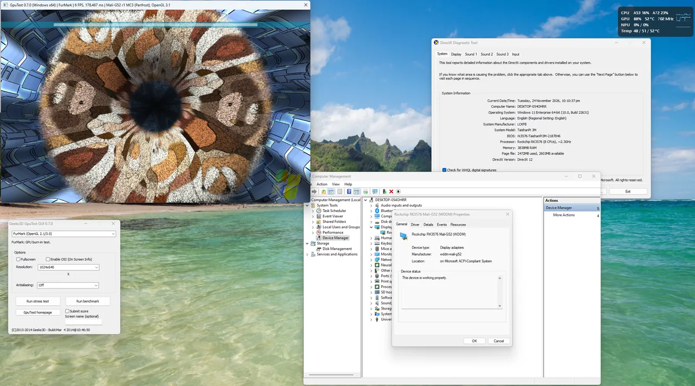

# wddm-mali-g52

A Windows (WDDM) driver for the Arm Mali-G52 GPU in the Rockchip RK3576.
The user-mode half is Mesa's Panfrost under Mesa's D3D10 frontend, with
[our patches](mesa-patches/). The kernel-mode half, `maliwddm`, is new and
owns the display as well. Windows on RK3576 boards
([woa-rk3576](https://github.com/gahingwoo/woa-rk3576)) otherwise draws its
desktop on the CPU.

## Status

Tested on the LCKFB TaishanPi 3M (and since 2026-11-26 the Radxa ROCK 4D, 12 GB) under Windows 11 23H2; the early
milestones ran on the ArmSoM CM5-IO. Switches and defaults:
[docs/SETTINGS.md](docs/SETTINGS.md).

| Feature | Status | Doc |
|---|---|---|
| Desktop composed on the GPU (DWM), VOP2 scan-out | board-tested | [PERF.md](docs/PERF.md) |
| WDDM 2.0 (falls back to 1.3 on a failed boot) | board-tested | [WDDM2.md](docs/WDDM2.md) |
| Direct3D feature level 10_1 | board-tested | [D3D11-UMD.md](docs/D3D11-UMD.md) |
| OpenGL 3.1 | board-tested | |
| ARM64, x64 and x86 programs | board-tested | |
| HDMI hot-plug, EDID modes and refresh rates, HDMI audio | board-tested | [HDMI-HPD.md](docs/HDMI-HPD.md), [DISPLAY-MODES.md](docs/DISPLAY-MODES.md) |
| Smaller modes scaled by the VOP2 | board-tested | [DISPLAY-MODES.md](docs/DISPLAY-MODES.md) |
| Panel and HDMI as an extended desktop (`HdmiExtend`) | off by default | [DUAL-DISPLAY.md](docs/DUAL-DISPLAY.md) |
| 702 MHz GPU clock on a 775 mV rail, thermal guard | board-tested | [PERF.md](docs/PERF.md) |
| GPU temperature and counters in Task Manager | board-tested | [PERFDATA.md](docs/PERFDATA.md) |
| Edge and Chrome page rendering on the GPU | blocked (software fallback) | [EDGE-PRESENT.md](docs/EDGE-PRESENT.md) |
| Video decode, H.264, HEVC, VP9, AV1, zero copy (`UmdVideo`), in Edge, Chrome and mpv | board-tested, on by default | [VIDEO-DECODE.md](docs/VIDEO-DECODE.md), [CHROMIUM-VIDEO.md](docs/CHROMIUM-VIDEO.md) |
| Feature level 11_0 for Chromium's video decoder (`UmdReportFL11`) | board-tested, on by default | [CHROMIUM-VIDEO.md](docs/CHROMIUM-VIDEO.md) |
| OpenCL (rusticl) | board-tested | [OPENCL.md](docs/OPENCL.md) |
| Vulkan 1.0 (panvk, not conformant, opt-in) | board-tested, windows at about 6 frames a second | [VULKAN.md](docs/VULKAN.md) |

Known limits: one board, and a heavy program makes the whole desktop wait.
All docs: [docs/](docs/README.md).

## Installing

Needs Windows 11 23H2 on ARM64, test signing on (Secure Boot off), and
[edk2-rk3576](https://github.com/gahingwoo/edk2-rk3576) firmware, which
powers the GPU and describes it in ACPI as `RKCP7402`. CI's
`wddm-mali-g52-driver-arm64` artifact is the driver package; the steps are
in [INSTALL.txt](drivers/maliwddm/INSTALL.txt).

Everything is built in GitHub CI; there is no local Windows toolchain.

## Hardware

| | |
|---|---|
| GPU | Mali-G52 (Bifrost, job manager), `rockchip,rk3576-mali` |
| Registers | `0x27800000`, 128 KiB |
| Interrupts | job SPI 347, MMU SPI 348, GPU SPI 349 (ACPI GSIV 379, 380, 381) |
| Power | domain `PD_GPU`; supply `vdd_gpu_s0`, RK806 BUCK5, 750 mV at power-on |
| Clock | `CLK_GPU`; the driver sets it, at most 600 MHz unless `GpuClkHigh` allows 702 |

## Acknowledgements

Thanks to [JLC](https://jlc.com/) (嘉立创) for sponsoring the LCKFB
TaishanPi 3M, its MIPI DSI screen, the fan and the EC20 4G module, and to
[ArmSoM](https://www.armsom.org/) for sponsoring the CM5 module and the
CM5-IO board.

## License

GPL-2.0, see [LICENSE](LICENSE). Code taken from Mesa keeps its own
licence, mostly MIT.
