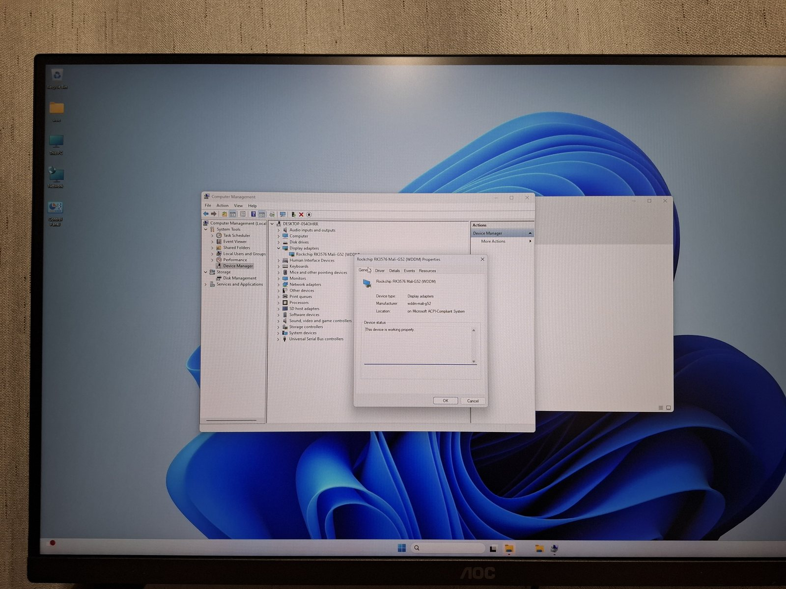
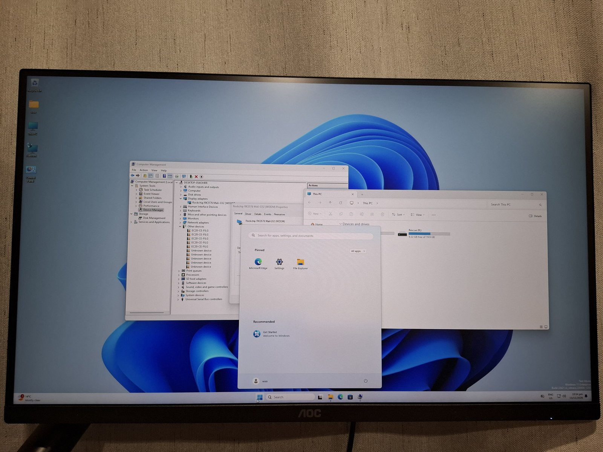
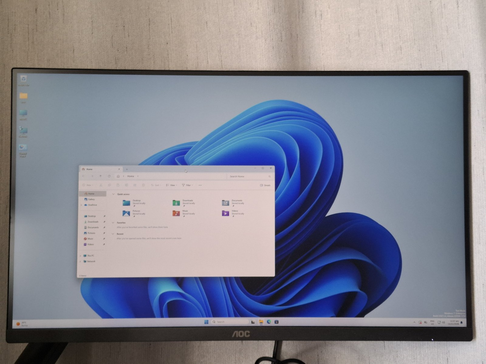
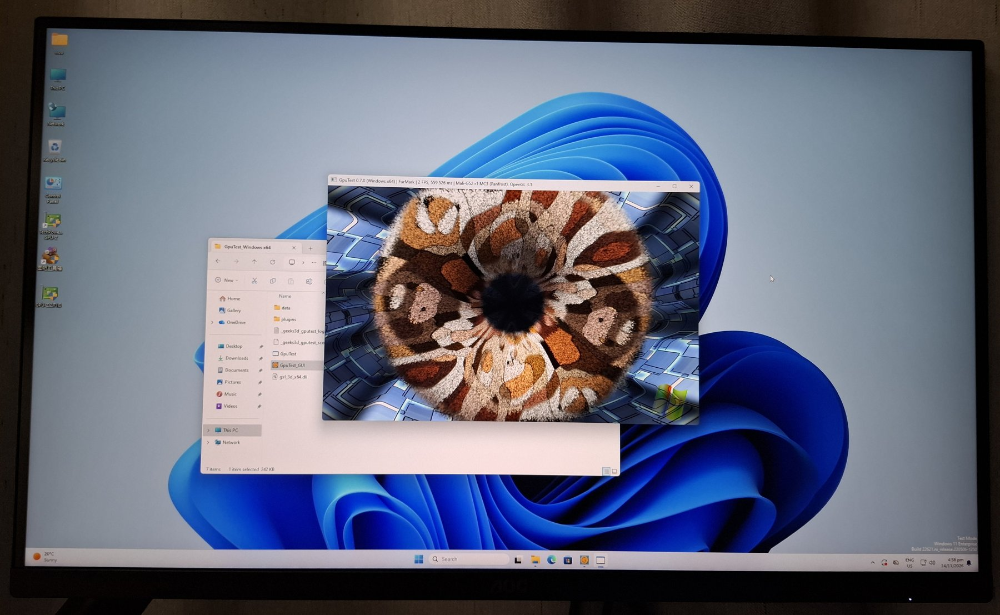
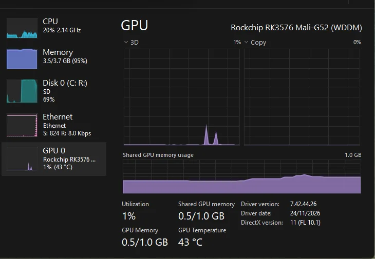

# wddm-mali-g52

A Windows (WDDM) driver for the Arm Mali-G52 GPU in the Rockchip RK3576.

*2026-11-13, LCKFB TaishanPi 3M. Windows 11 lists the Mali-G52 as a working
display adapter and draws its desktop on it: the screen in this photo was
composed on the GPU.*

| | |
|---|---|
|  |  |
| The Start menu, File Explorer and Device Manager, 2026-11-13 | A day later: the display controller reads the frame itself and no pixel is copied on the CPU |

*2026-11-14. FurMark (GpuTest 0.7.0, an x64 program) through the OpenGL 3.1
driver: 285 points at 1024x640 with the GPU at 594 MHz.*

On 2026-11-13 it ran at a frame or two a second. A day later, with the copies
gone and the display controller reading the primary itself, the desktop keeps
up with a dragged window: [what was measured](docs/results/tspi3m-2026-11-14/README.md),
[how the first picture was reached](docs/results/tspi3m-2026-11-13/README.md).
Programs built for x64 and x86 can use it as well as ARM64 ones, and it has
an OpenGL 3.1 driver beside the Direct3D one. It is still a first driver:
Direct3D feature level 10_0 by default (10_1 behind a setting), one display
at a time, one board, and a heavy program makes the whole desktop wait.

The Mali-G52 draws under Windows: on 2026-10-02 Mesa's Panfrost, inside the
D3D10 software-driver DLL and talking to our own kernel driver, rendered a
D3D11 triangle on it, byte for byte what the CPU renderer draws (M4). On
2026-11-13 the Windows 11 desktop was composed on it: `dwm.exe`,
`explorer.exe` and the rest render through Panfrost and the WDDM driver puts
the result on the monitor
([photo](docs/results/tspi3m-2026-11-13/desktop-on-mali.jpg),
[what was done](docs/results/tspi3m-2026-11-13/README.md)). It ran at a
frame or two a second that night; the Start menu, the tray and File Explorer
came up a few hours later
([photo](docs/results/tspi3m-2026-11-13/start-menu-on-mali.jpg)). On
2026-11-14 the copies were removed one at a time and measured
([result](docs/results/tspi3m-2026-11-14/README.md)).

Without this driver, Windows on RK3576 boards
([woa-rk3576](https://github.com/gahingwoo/woa-rk3576)) draws its desktop on the
CPU: DWM renders through WARP into the framebuffer the firmware leaves
behind. No Windows driver for any Mali GPU
exists as far as we can find; Arm and the SoC vendors ship Linux and Android
drivers only.

## Screenshots, 2026-11-24

*TaishanPi 3M, Windows 11 23H2, 2026-11-24. FurMark on "Mali-G52 r1 MC3
(Panfrost), OpenGL 3.1", Device Manager's "Rockchip RK3576 Mali-G52 (WDDM)"
working properly, dxdiag, and a monitor widget with the GPU at 702 MHz.*

*TaishanPi 3M, Windows 11 23H2, 2026-11-24. Task Manager's GPU page:
utilisation, shared GPU memory, the GPU temperature, driver date and
DirectX 11 at feature level 10_1.*

## Where it stands

| | Milestone | State |
|---|---|---|
| M0 | Feasibility checks | done |
| M1 | The Mali runs a job under Windows (plain KMDF driver) | done 2026-10-01, [result](docs/results/m1/) |
| M2 | Mesa 26.2 (D3D10 frontend, softpipe, Panfrost) built for Windows ARM64 in CI | done |
| M3 | Panfrost drives the Mali through our own kernel interface; first clear | done 2026-10-02, [result](docs/results/m3/) |
| M4 | First triangle, byte-identical to the CPU renderer | done 2026-10-02, [image](docs/results/m4/first-triangle-on-mali-windows.png) |
| M5.1 | Display-only driver drives HDMI | done 2026-10-02, [result](docs/results/m5.1/README.md) |
| M5.2 (b) | A job submitted through the WDDM driver | done 2026-10-02, [result](docs/results/m5.2-step-b/README.md) |
| M5.2 (c) | The triangle through the WDDM driver, Mesa loaded by the runtime as the UMD | done 2026-10-03, [result](docs/results/m5.2-step-c2/README.md) |
| M5.2 (d) | DWM composites on the Mali in installed Windows | **desktop on screen 2026-11-13**, [result](docs/results/tspi3m-2026-11-13/README.md); the desktop, the Start menu, File Explorer and Device Manager draw. Speed, memory and hitches measured and worked on 2026-11-14, x64 and x86 programs and OpenGL added the same day, [result](docs/results/tspi3m-2026-11-14/README.md) |

### On the TaishanPi 3M under Windows, 2026-11-23

What the board has shown, and nothing more. Each line links to the
document with the runs behind it.

| Area | State |
|---|---|
| Desktop on the Mali (DSI panel) | Works: DWM composes on the GPU and the VOP2 scans the frame out. The panel's ribbon cable broke on 2026-11-23, so the later runs were on HDMI. |
| HDMI hot-plug | Works with `HdmiHpd` 3: the desktop on a 2560x1440 monitor at its own timing, with HDMI audio. Unplugging lights the panel again after about a second, and plugging back returns to HDMI with sound. `HdmiExclusive` is on by default at level 3, so HDMI and the panel take turns; both at once (extend or duplicate) is planned, not written. `HdmiHpd` is 3 by default on an HDMI boot and 0 on a DSI panel boot; a value set by hand wins. [HDMI-HPD.md](docs/HDMI-HPD.md) |
| Display resolution and refresh rate | Works on HDMI (2026-11-24, AOC Q27B3S2): Settings offers every mode and refresh rate the monitor's EDID lists up to 340 MHz, 2560x1440 at 60 and 75 Hz there; 75 Hz took, the monitor showed it, it was kept across a reboot, and hot-plug and the 15 s revert worked. That is `HdmiHpd` 3, the default on HDMI boots (branch `hdmi-retime-default`). 100 Hz at 2560x1440 needs HDMI 2.0 scrambling, not written. Below level 3 and on the panel, `ScaledModes` offers smaller resolutions scaled by the VOP2. Scale (DPI) changes work. [DISPLAY-MODES.md](docs/DISPLAY-MODES.md) |
| Edge | Partly. With `UmdDdi` 101, Edge's GPU process gets the Mali at feature level 10_1 and ANGLE reports WebGL2 on it. The device-creation fix and the fixes for the crashes found on the board (a draw with no input layout, a shared resource given a cached buffer) are merged. Presenting to a composition swap chain is still blocked: Edge loses its device at the first present and falls back to software rendering. That waits on the redirection and DWM work. [EDGE-CREATEDEVICE.md](docs/EDGE-CREATEDEVICE.md), [EDGE-PRESENT.md](docs/EDGE-PRESENT.md) |
| WDDM 2.0 | The default since 2026-11-24. First 2.0 desktop on 2026-11-24 (run G): LogonUI and the desktop on HDMI, GPU jobs through WDDM, dxdiag Driver Model WDDM 2.0, feature level 10_1. A 2.0 boot that does not reach a confirmed desktop falls back to 1.3 on the next boot and stays there until another package is installed. `WddmProbe` 0x1300 forces 1.3. [WDDM2.md](docs/WDDM2.md) 16.12 and 16.13 |
| GPU speed | FurMark (1024x640, 60 s) scores 288 and 290 at 594 MHz with the GPU 87.9% busy: the clock is the limit. Dragging a window keeps the GPU 12 to 13% busy and is limited by the CPU's submit path. Sending a batch's two GPU chains as one render cut DWM's submit CPU per job from 0.29 to 0.33 ms to 0.20 to 0.23 ms over three runs, with no errors; that is on by default since 2026-11-23 (`UmdMergeSubmit`). [PERF.md](docs/PERF.md) |
| GPU clock and supply | At most 600 MHz (594 MHz used). The GPU supply, `vdd_gpu_s0` (RK806 BUCK5), reads 750 mV, the PMIC's default. A firmware branch raises it to 775 mV on this board, and the board read it back at 775 mV (edk2-rk3576 `main` since 2026-11-24). With `GpuClkHigh` 1 the GPU ran FurMark at 702 MHz on 2026-11-24: 334, 335 and 336 points against 288 and 290 at 594 MHz, no job faults, 49.9 C peak with the fan on. `GpuClkHigh` is 0 unless set, so 594 MHz stays the default. |

All results: [docs/results/](docs/results/README.md). All documents:
[docs/](docs/README.md).

## How it is built

The user-mode half comes from Mesa: the Panfrost Gallium driver and its
Bifrost shader compiler, under Mesa's D3D10 frontend, with the changes in
[mesa-patches/](mesa-patches/). The kernel-mode half is new: `malikm`, a plain
driver with its own job-submission interface, and `maliwddm`, a WDDM 2.0
driver (1.3 on request) that also owns the display. A shim in
[win32-compat/](win32-compat/) stands in for libdrm between Panfrost and
either of them.

Mesa's D3D10 frontend is a software-driver interface, so M3 and M4 run D3D11
programs that ask for the software driver; only M5 puts the desktop on the
GPU. The reasoning and the risks are in [docs/PLAN.md](docs/PLAN.md),
[docs/M2-PLAN.md](docs/M2-PLAN.md) and
[docs/M5.2-PLAN.md](docs/M5.2-PLAN.md).

Everything is built in GitHub CI; there is no local Windows toolchain.

## Installing

CI's `wddm-mali-g52-driver-arm64` artifact is the driver package: the INF,
`maliwddm.sys`, the Direct3D UMD and the OpenGL ICD (Mesa's DLLs, built for
ARM64, x64 and x86 processes) and their catalog, all signed with a test
certificate that comes with it. Its
[INSTALL.txt](drivers/maliwddm/INSTALL.txt) has the steps: test signing on,
trust the certificate, `pnputil /add-driver`. It needs the firmware below.

## Hardware

| | |
|---|---|
| GPU | Mali-G52 (Bifrost, job manager), `rockchip,rk3576-mali` |
| Registers | `0x27800000`, 128 KiB |
| Interrupts | job SPI 347, MMU SPI 348, GPU SPI 349 (ACPI GSIV 379, 380, 381) |
| Power | domain `PD_GPU`; supply `vdd_gpu_s0`, RK806 DCDC5 (BUCK5), 750 mV at power-on on the TaishanPi 3M |
| Clock | `CLK_GPU`, set through TF-A's SCMI service on Linux |

Developed on the ArmSoM CM5-IO and the LCKFB TaishanPi 3M, with firmware from
[edk2-rk3576](https://github.com/gahingwoo/edk2-rk3576). M1 to M5.2 step (c)
were done on the CM5-IO; the first picture from DWM came on the TaishanPi 3M. The firmware has to power the GPU and describe it in
ACPI (`RKCP7402`); edk2-rk3576 does both on these two boards.

## Acknowledgements

Thanks to [JLC](https://jlc.com/) (嘉立创) for sponsoring the LCKFB TaishanPi 3M, its MIPI DSI screen, the fan and the EC20 4G module used for this work, and to [ArmSoM](https://www.armsom.org/) for sponsoring the CM5 module and the CM5-IO board.

## License

GPL-2.0, see [LICENSE](LICENSE). Code taken from Mesa keeps its own licence,
mostly MIT.
