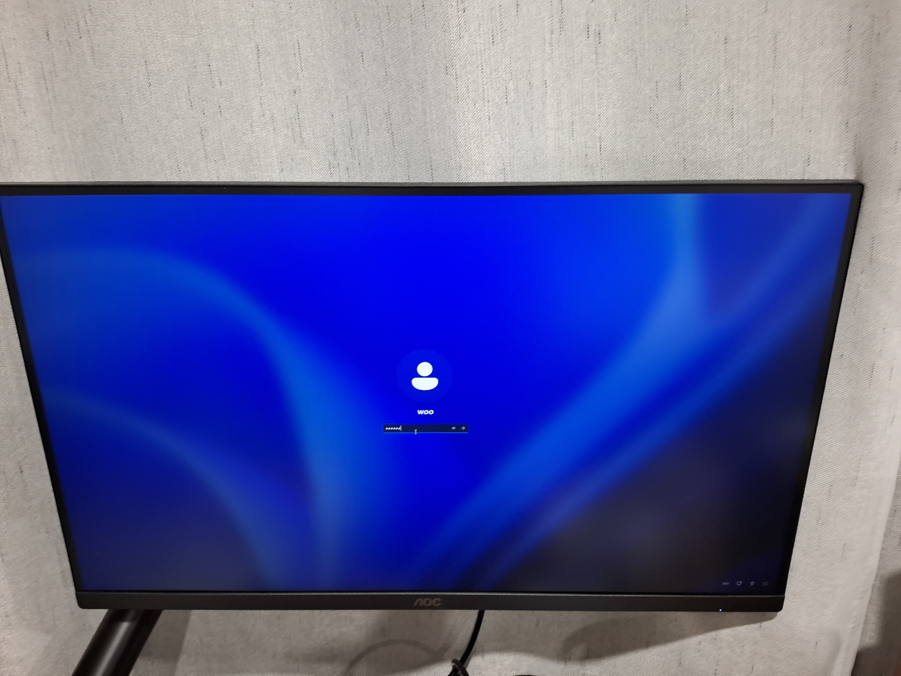

# 2026-11-13: the sign-in screen composed on the Mali-G52

Board: LCKFB TaishanPi 3M (RK3576, 4 GB), Windows 11 23H2 (22631) installed
on the eMMC, 2560x1440 over HDMI. Firmware: edk2-rk3576 `00b82c4`, which
powers the GPU and declares it as `ACPI\RKCP7402`. Everything here is on the
branch `umd-file-log`; none of it is on `main`.

What is on the monitor in that photo:

- `LogonUI.exe` renders the sign-in screen with Panfrost into a shared
  surface.
- `dwm.exe` opens that surface, composites it with Panfrost into its own
  swap chain, and presents by flipping.
- `maliwddm` takes each flip and copies the new primary to the firmware's
  framebuffer at the emulated vertical sync.

The wallpaper, the account picture, the user name, the password box with the
typed dots, the icons in the corner and the mouse pointer are all right.

It is slow, about 1 to 2 flips a second with the sign-in screen up and 5 to 6
with an empty desktop. Every frame is read back from Panfrost's buffer and
copied twice on the CPU at 2560x1440.

The first version of this picture, earlier the same evening, had no text and
no account picture: [logon-screen-on-mali-no-text.jpg](logon-screen-on-mali-no-text.jpg).
Both causes were found with a Direct2D test that runs over SSH (item 12
below).

An earlier photo, before `LogonUI.exe` got as far as presenting, shows DWM's
empty desktop and the pointer: [dwm-on-mali-cursor-only.jpg](dwm-on-mali-cursor-only.jpg).

## Counters at that point

From `m5test` and the driver's trace values, on one boot:

- 40473 render jobs done, 0 failed, 0 timed out.
- 12369 flips, 12365 copied to the framebuffer.
- `dwm.exe` one process since it was last started; `LogonUI.exe` one process
  and no crash on four starts. Before the shared surface work it crashed
  every 8 seconds.
- No assertion and no unimplemented entry point in either process's log.

## Before this day

M5.2 step (c) had passed in WinPE: a triangle through the WDDM driver with
Mesa loaded as the UMD. Step (d), DWM in installed Windows, had been tried
once on the CM5-IO on 2026-10-17 and ended with a black screen and a shell
that crash-looped.

## What stood in the way, in the order it was found

Each one was read from a log line, not guessed. The two guesses made along
the way (that `OpenResource` was the first thing missing, and that
`DXGI_STATUS_NO_REDIRECTION` was) were wrong about where things stopped.

1. **16 viewports for a driver that has one.** `dwm.exe` and `LogonUI.exe`
   created a device and then did nothing. They were sitting in an assertion
   box, `pan_context.c:496: num_viewports == 1`, on the secure desktop where
   no key reaches it ([photo](assert-num-viewports.jpg)). Direct3D 10 clears
   all 16 viewport slots when a device is set up and the frontend passed them
   all on.
2. **Assertions that stop a process.** They now go to a file and execution
   continues, so one run lists everything it hits.
3. **Fragment position.** `tgsi_to_nir` asserted on a position input when
   the driver wants a system value, although it had already made the right
   variable.
4. **No SAMPLE opcodes.** The frontend emits Direct3D 10 style sampling,
   with the sampler and the sampler view as separate registers.
   `tgsi_to_nir` only knew the combined TEX family, so no textured shader
   had ever gone through Panfrost here. Eight opcodes added.
5. **Constant buffers.** Panfrost pushed uniform words only from user
   buffers; Direct3D 10 constant buffers are resources. Every shader ran
   without its constants (207 assertions in one run).
6. **Primaries the runtime knows.** Every present returned `E_INVALIDARG`:
   the shim presented an allocation of its own. Primaries are now allocated
   through the runtime with the resource handle, and their allocations
   rotate with `RotateResourceIdentities`.
7. **Two caps inside the wrong `#if`.** `SectionBackedPrimary` and
   `FlipOnVSyncMmIo` had been added inside `#if MW_RENDER_ONLY` and were 0
   in the only build there is.
8. **`SetDisplayMode` was a stub.** DXGI calls it to move the display to the
   swap chain. Without it dxgkrnl answered every flip with
   `STATUS_GRAPHICS_PRESENT_MODE_CHANGED`. The frontend's own log said so
   1887 times (`_SetDisplayMode XXX`) and I looked at the kernel's status for
   an iteration before reading it.
9. **The driver refused flips.** `MwPresent` wanted DMA private data, which a
   flip does not have (`Fail_Present 0xC000000D`).
10. **Two shaders `LogonUI.exe` needs.** An indirect read of plain
    temporaries, and `SV_VertexID`, which Bifrost's compiler has no
    intrinsic for in its zero-based form.
11. **Shared surfaces.** A resource created with
    `D3D10_DDI_RESOURCE_MISC_SHARED` is now backed by an allocation the
    runtime owns, `OpenResource` builds a resource on the opened allocation,
    and a shared surface is presented as it is. The kernel driver needed no
    change: one GPU address space and `OpenAllocation` were enough.
12. **Direct2D's text and bitmaps.** `tools/windows/d2dtext.cpp` draws a
    rectangle, an ellipse, two lines of text and a bitmap with Direct2D and
    saves the frame, on the Mali or on WARP. On the Mali only the rectangle
    was right ([before](d2dtext-mali-run-43389770021.png),
    [WARP](d2dtext-warp.png)). Two causes, both in `tgsi_to_nir`:
    - Vertex inputs were all declared float, so Bifrost converted integer
      elements to float and the shader used the float's bits as an integer.
      Direct2D indexes a constant buffer with such an input, one entry per
      primitive, and found nothing past entry 0. That lost the ellipse and
      the bitmaps.
    - Nothing told Panfrost which sampler views are texel buffers, so a
      pixel shader that fetches from one had no attribute array and read
      zero. Direct2D keeps glyph coverage in a buffer. That lost the text;
      `tools/windows/d3dparts.cpp` found it, one feature per draw.

    With both fixed the Mali's frame has the same number of text pixels as
    WARP's (2089 and 2290 for the two lines) and 72 pixels of 131072 differ
    by more than 8, at the edge of the ellipse and in the filtered bitmap
    ([after](d2dtext-mali-run-43394072587.png)).

The commits on the branch say what was observed for each.

## How it was debugged

- The UMD writes every entry point, every shader's TGSI and its own messages
  to `C:\mali\log\<exe>-<pid>.txt` while that directory exists, and
  assertions to `<exe>-<pid>-assert.txt`.
- A new UMD does not need a reboot: rename `System32\maliumd.dll`, copy the
  new one, end `LogonUI.exe` and `dwm.exe`; Windows starts both again.
- The kernel driver keeps counters and its last failing call per DDI under
  the device's `Device Parameters\maliwddm` key.
- dxgkrnl events are decoded with `tools/etw/`.
- A second Windows on the same eMMC is the default boot entry while a new
  kernel driver is tried, with a one-time boot into the system under test.

When something stops, in this order: `XXX` and `SetError` lines in the UMD
log, `Fail_*` in the driver's key, assertions, the Application event log,
then dxgkrnl events.

## Open

- Speed: render into the primary instead of reading back and copying, then
  scan out the primary directly.
- With the display asleep, `dwm.exe` closed the shared surfaces two seconds
  after opening them (seen once).
- `DXGI_STATUS_NO_REDIRECTION` is still returned from `CreateDevice`; what
  windowed applications need has not been looked at.
- Nothing past the sign-in screen has been tried: signing in, the shell, any
  application.
- Not run on the CM5-IO.

## Files

Photos of the monitor are next to this file. Everything else is in
[logs/](logs/):

| Files | What |
|---|---|
| `umd-*.txt`, `traces-after-sample.txt`, `dwm-trace-with-tgsi.txt`, `logonui-trace-shared-resource.txt` | UMD logs at each stage |
| `dxgkrnl-*.txt` | decoded dxgkrnl events |
| `m5test-after-clean-boot.txt`, `maliwddm-trace-after-clean-boot.txt`, `session1-processes.txt` | the first clean boot with the driver bound |
