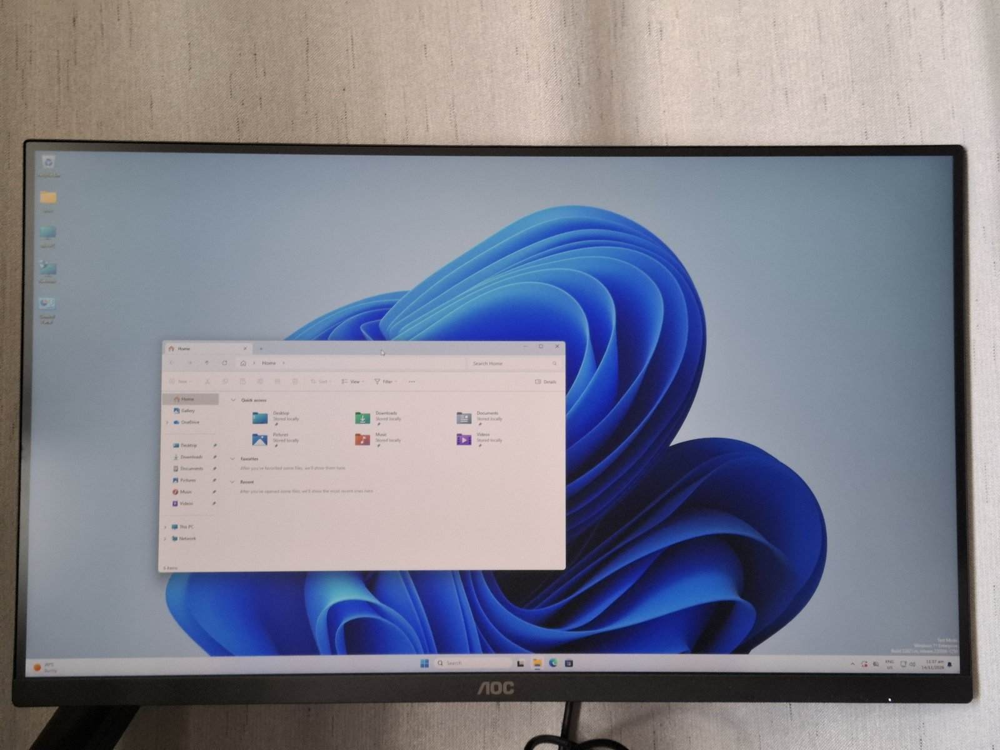

# 2026-11-14: from a frame or two a second to a desktop that keeps up

Board: LCKFB TaishanPi 3M (RK3576, 4 GB), Windows 11 23H2 on the eMMC,
2560x1440 over HDMI, firmware edk2-rk3576 `00b82c4`. Everything here ran on
that board that day, in the order given. The measurements and how to repeat
them are in [docs/PERF.md](../../PERF.md); this page is what was found.

## Speed

`dwm.exe` with a window being dragged, presents in 5 s:

| Change | Presents in 5 s |
|---|---|
| as on 2026-11-13 | 41 to 45 |
| the rotate exchanges buffers instead of copying them | 35 to 46 |
| Panfrost renders into the primary | 46 to 55 |
| the copy to the framebuffer on a thread, not in the vsync DPC | 63 to 92 |
| the VOP2 scans out the primary; no copy | 135 to 268 |

Two of these did nothing by themselves, and that was the finding. The
rotate cost 76 ms a present and removing it left the rate where it was,
because the rate was being set somewhere that had not been measured: the
copy to the firmware framebuffer in the timer's DPC, which halved the
emulated vsync whenever something moved.

Scan-out uses the VOP2's own IOMMU, so a primary's pages stay wherever
VidMm put them. It is off after every boot; `m5test scan 1` turns it on.

## Memory

`m5test mem`, new that day, gives GPU memory by process.

- Panfrost makes a 128 MB tiler heap for every screen. The frontend has
  made a screen for every Direct3D device since the explorer fix of
  2026-11-13, and the shim allocates the heap whole. `dwm.exe` held
  171.6 MiB and `LogonUI.exe` 163.5, 128 of each the heap.
- With 32 MB, `dwm.exe` held 119.2 MiB, `explorer.exe` (five devices) 210,
  and 24408 jobs ran with none failed. 32 MB is now the default.
- Committed memory on the desktop went from 4760 MB to 3233 MB between the
  morning and the afternoon. That is one comparison, with different things
  open.

## Hitches

The desktop stalled for a moment now and then. A log of every operation
over 20 ms (`C:\mali\slow`) said what it was, twice.

- Panfrost asks with a timeout of 0 whether a buffer is busy before it
  reuses one from its cache. The shim ignored the timeout and waited for
  the whole queue with its process-wide lock held: 38 waits of up to 95 ms
  in 605 s of `dwm.exe`, nearly all for a 64 KB pool buffer.
- The first fix kept the timeout but still answered for the whole queue,
  and I called it fixed after 67 s. With any job outstanding every buffer
  was busy, so Panfrost made a new one each time: `dwm.exe` created 114033
  allocations in a session where it had created 422, its slow log went from
  13.5 to 31.3 ms a second, and PresentMon had it at 24 frames a second
  with a 1% low of 5 and a worst frame of 1.8 s.
- Now each submission's completion event is kept with its number and each
  buffer remembers the last submission that named it. In the eleven minutes
  after that `dwm.exe` created 136 allocations and logged nothing slow
  beyond the shaders it compiles at start; the board was nearly idle for
  those minutes, and the 1% low has not been read again.
- Copies between textures go through the blitter on the GPU; Panfrost did
  them on the CPU at 22 to 26 ms each. The Direct2D test frame is byte for
  byte the same before and after.
- Left: creating shaders when a process starts (40 to 50 ms each, no cache
  on disk).

## Programs under emulation

An x64 and an x86 process both got `0x887A0004` from `D3D11CreateDevice`
on the Mali: one cannot load an ARM64 DLL, the other was given no name to
load. `System32\maliumd.dll` is now an ARM64X forwarder to an ARM64 and an
x64 build of the UMD, and an x86 build sits in SysWOW64 under
`UserModeDriverNameWow`. `emucheck` draws its triangle on the Mali from all
three kinds of process, 80 times in a row from the two emulated ones with
no failure and no GPU memory left behind.

## OpenGL

There was no OpenGL driver, so programs got Windows' GL 1.1 software
implementation, and GpuTest crashed at address 0 calling a GL 2 entry
point. Mesa's WGL frontend on Panfrost is now the adapter's ICD, for ARM64,
x64 and x86: `GL_RENDERER` is `Mali-G52 r1 MC3 (Panfrost)`, OpenGL 3.1,
through Windows' own `opengl32.dll`. A frame is read back and drawn with
GDI, so it is correct and not fast.

GpuTest 0.7.0 FurMark, 1024x640 windowed, 60 s, one run each:

| GPU clock | Score | Frames a second |
|---|---|---|
| 198 MHz | 106 | 1 |
| 594 MHz | 285 | 4 |

## The GPU's clock

The firmware leaves the GPU at 198 MHz, the rate the device tree assigns
before Linux raises it; the operating points run from 300 to 950 MHz.
Nothing in Windows raised it, so every figure on this page above this
section was taken at 198 MHz. `m5test clk` now sets it, up to 600 MHz,
which is as far as the lowest supply voltage is specified for, and it is
stored to be applied at every start. 27784 jobs at 594 MHz including the
FurMark run, none failed.

With FurMark running the whole desktop stalls and the pointer lags: one
job chain runs at a time, a FurMark frame is one long job, and
`dwm.exe`'s wait behind it (3.4 flips a second at 198 MHz). Preemption by
soft-stop is written (branch `next`) and has not run on the board.

## Bugs found on the way

1. **The elevation prompt crashed, so nothing that needs elevation could
   start.** `consent.exe` and `LogonUI.exe` create a device, destroy it and
   unload the driver. The exception handler the UMD's log installs was
   never removed, and the next exception ran unloaded code
   (`maliumd.dll_unloaded` in the Application log). The DLL now pins itself
   in the process. Introduced on 2026-11-13 with the crash reporter.
2. **A page fault in the VOP2's IOMMU, and a screen of flickering lines.**
   Releasing a primary pointed the window back at the framebuffer and
   cleared the primary's entries at once, but the window moves at the next
   frame start. Found by ending `dwm.exe` a dozen times in a row; a sign-out
   or a shutdown takes the same path. The entries now stay until the slot
   is reused. After the fix: three restarts of `dwm.exe`, a sign-out, and a
   restart of Windows with scan-out on, no fault.
3. **My own:** ending `dwm.exe` repeatedly to rename a log directory made
   Windows give up restarting it (seven restarts), and the session had to
   be signed out. The log is now turned off with a file.

## The driver as a package

The kernel driver, the Direct3D UMD and the OpenGL ICD (each for three
kinds of process, with two forwarders) and a null driver for the display
controller are installed from one signed package
(`wddm-mali-g52-driver-arm64` from CI). Nothing is copied by hand any
more. `Get-AuthenticodeSignature` on the installed DLL says Valid, and
Windows shows a chip type and a DAC type for the adapter.

## What dxdiag says

Feature levels 10_0, 9_3, 9_2, 9_1; driver model WDDM 1.3; 0 MB of display
memory and 1024 MB shared; DirectDraw acceleration not available; the
monitor is "Generic Non-PnP Monitor".

## Not done, and known wrong

- With a heavy program running the desktop and the pointer stall. See
  above; preemption is written and untested.
- The monitor's EDID does not reach Windows. The firmware side
  (edk2-rk3576 branch `acpi-edid`) and the driver side are written; the
  firmware has not been flashed, and the driver behaves as before without
  it.
- One display mode, the firmware's. Smaller modes scaled by the VOP2 are
  designed and sit behind a setting that is off; one scaler register's
  reset value is not known, and nothing is written to it yet.
- Scan-out is not on by default, the vsync is still a timer, and display
  off and on, sleep and the bugcheck screen have not been tried with it.
- The GPU runs at 594 MHz of a possible 950; more needs the supply voltage
  raised, and there is no temperature read-out or thermal protection under
  Windows yet.
- OpenGL presents through a CPU read-back, and its waits still drain the
  whole queue.
- No video decoding: the RK3576's decoder is separate hardware with no
  Windows driver, and the Direct3D video interfaces DXVA Checker looks for
  need the Direct3D 11 DDI. No HDMI audio either; that is woa-rk3576's
  side and is written, not tested.
- No shader cache; Direct3D feature level 10_0 only; geometry shaders and
  stream output fail cleanly and are not implemented.
- Not run on the CM5-IO since 2026-10-17.
